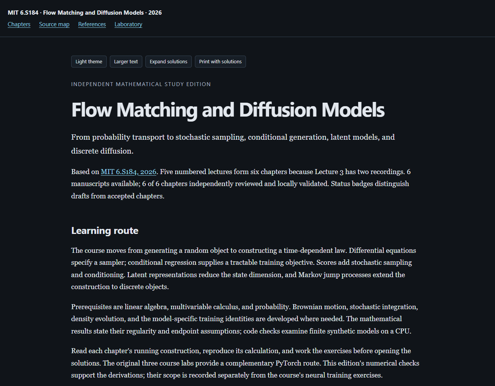

# MIT 6.S184 — Flow Matching and Diffusion Models

**[Read the live textbook](https://az9713.github.io/mit-6s184-flow-diffusion-notes/)**

[](https://az9713.github.io/mit-6s184-flow-diffusion-notes/)

An independent mathematical study edition based on the exact
[MIT 6.S184 course, 2026](https://diffusion.csail.mit.edu/2026/index.html).
The course recordings and written materials **serve as the spine**: they set the
topic sequence and supply timestamped anchors. Five numbered lectures form six
chapters because Lecture 3 is split
into score matching and guidance recordings.

The course supplies the sequence. This edition adds independent derivations,
defined assumptions, worked constructions, runnable numerical checks, exercises
with full solutions, and primary-source research integrated into the exposition.
It is not an official MIT publication or endorsement.

The book contains **six chapters, about 30,000 prose words, 36 fully worked
problems, six runnable Python programs, and six computed figures**. Each chapter
passed an independent scientific editor. Original recordings, raw captions,
slides, course notes, downloaded research, and lab notebooks remain outside
this directory. The [workflow](WORKFLOW.md) records the production gates.

Open `index.html` locally. Mathematics and reader assets are bundled for offline
use. Recording and research links require the internet.

## Chapters

1. [From generation to probability transport](https://az9713.github.io/mit-6s184-flow-diffusion-notes/chapter-01.html)
2. [Flow matching](https://az9713.github.io/mit-6s184-flow-diffusion-notes/chapter-02.html)
3. [Scores, denoising, and stochastic sampling](https://az9713.github.io/mit-6s184-flow-diffusion-notes/chapter-03.html)
4. [Conditioning and classifier-free guidance](https://az9713.github.io/mit-6s184-flow-diffusion-notes/chapter-04.html)
5. [Latent models and neural architectures](https://az9713.github.io/mit-6s184-flow-diffusion-notes/chapter-05.html)
6. [Discrete diffusion and jump processes](https://az9713.github.io/mit-6s184-flow-diffusion-notes/chapter-06.html)

The [source map](https://az9713.github.io/mit-6s184-flow-diffusion-notes/source-map.html) distinguishes lecture content, researched
extensions, and original teaching constructions. The [references](https://az9713.github.io/mit-6s184-flow-diffusion-notes/references.html)
give the primary locators used. The [laboratory](https://az9713.github.io/mit-6s184-flow-diffusion-notes/laboratory.html) links the code
and saved results, including actual affine-flow fitting and tabular discrete
learning, together with exact Gaussian, variational, and finite-state checks.

The dark-default reader includes chapter search, a section index, light theme,
larger text, expandable solutions, code copying, and printing with solutions.
MathJax and rendering assets are bundled, so reading works offline.

## Rebuild and verify

The chapter programs and builder use Python's standard library. The validators
need the pinned packages below. Browser checks use an installed supported Chrome
or Playwright Chromium; the installation command downloads Chromium if needed.

```sh
python -m pip install -r requirements.txt
python -m playwright install chromium
python tools/build_book.py
python tools/check_chapter_code.py
python tools/validate_book.py --browser
```

The code checker executes copied programs in an isolated temporary book. Some
programs intentionally write their saved result files. Numerical comparisons
exclude only declared creation timestamps and runtime fields. Independent
scientific calculations and exercise review are recorded separately from
execution and browser checks.

## Evidence and limits

See the [editorial record](editorial-review-summary.json),
[code checks](chapter-code-validation.json), and
[reader checks](reader-validation.json). Final package evidence is recorded in
`completion.json`, `source-free-validation.json`, and `package-validation.json`.

Authors read the complete assigned automatic-caption text sequentially and
checked technical claims against official written materials and inspected
primary sources. Recording anchors locate related topics; they do not attribute
all nearby mathematics or examples to the instructors. Source conventions,
endpoint assumptions, and discrepancies are explained in the source map.

The finite computations support the declared constructed models. They do not
reproduce neural image-model training, research benchmarks, or production-system
latency. Full audiovisual review, complete visual inspection of every source
page, real-system clipboard verification, and human accessibility certification
are not claimed. The series consistency audit is distinct from a new independent
mathematical rereview of every proof in the assembled book.

Third-party source rights remain with their creators. No blanket license is
asserted over MIT's materials or the linked research. MathJax retains its bundled
license. Published instructor and research-author names are retained for source
attribution. Raw sources, private editorial records, and local working files are
excluded from this repository.

GitHub Pages serves the `main` branch at the repository root, matching the
predecessor reading editions. The preview above opens the live book.
The [publication check](publication-validation.json) records deployment checks
and their scope separately from the scientific and offline reader reviews.
